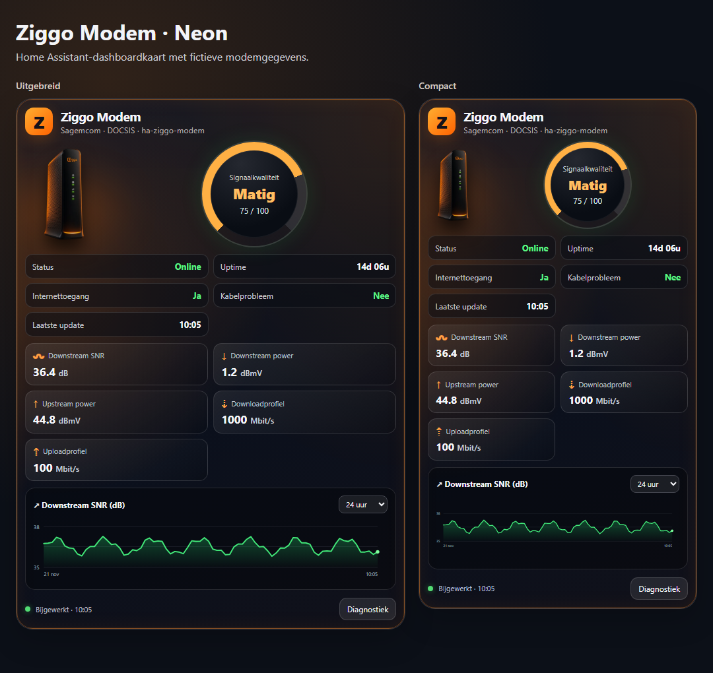

# Ziggo Modem · Neon

[English documentation](docs/README.en.md)

Een dashboardkaart voor Home Assistant die de signaalkwaliteit, verbinding en DOCSIS-metingen van je Ziggo-modem bij elkaar brengt. Open **Diagnostiek** om te zien waarom de integratie een bepaalde signaalscore geeft.



## Wat je nodig hebt

- Home Assistant met een dashboard waarop je aangepaste kaarten kunt toevoegen.
- De Ziggo Modem-integratie, geïnstalleerd en gekoppeld aan je modem. Die integratie levert de sensoren en berekent de score. [Installatiehandleiding van ha-ziggo-modem](https://github.com/dkwolf1/ha-ziggo-modem#readme)
- Voor de grafiek moet Home Assistant de downstream-SNR-sensor opnemen in Recorder.

## Installeren

### Met HACS

1. Open **HACS → ⋮ → Aangepaste repositories**.
2. Plak de GitHub-URL van deze repository en kies **Dashboard** als type. Voeg de repository toe.
3. Open **Ziggo Modem · Neon** in HACS, kies **Downloaden** en vernieuw de browserpagina.
4. Open je dashboard in bewerkmodus, kies **Kaart toevoegen** en zoek naar **Ziggo Modem · Neon**.

### Handmatig

1. Kopieer [`ziggo-modem-card.js`](dist/ziggo-modem-card.js) en [`ziggo-modem-device.webp`](dist/ziggo-modem-device.webp) naar dezelfde map in Home Assistant, bijvoorbeeld `/config/www/ziggo-modem-card/`. Als je de hoofdmap `www` net hebt aangemaakt, herstart Home Assistant één keer.
2. Ga naar **Instellingen → Dashboards → ⋮ → Bronnen**. Voeg `/local/ziggo-modem-card/ziggo-modem-card.js?v=1` toe als **JavaScript-module**. Zie voor bronnen die via YAML beheerd worden de Home Assistant-handleiding. [Dashboardbronnen registreren](https://contributors.home-assistant.io/frontend/custom-ui/resources/)
3. Vernieuw de browserpagina en voeg **Ziggo Modem · Neon** toe via de kaartkiezer.

Gebruik één dashboardbron voor deze kaart. Als je al een testversie uit `/local/ziggo-neon-test/` gebruikte, vervang dan die bron door de nieuwe.

## Instellen

De kaart vindt Ziggo-entiteiten automatisch via het Home Assistant-entiteitenregister. Heb je meer modems, selecteer dan het juiste **Modem/apparaat** in de kaarteditor. Daar stel je ook de weergave, taal, grafiek en **Tegels op de kaart** in. De beschikbare diagnosewaarden blijven zichtbaar in **Diagnostiek**, ook als je ze als tegel uitvinkt.

Minimale YAML voor een handmatige kaart:

```yaml
type: custom:ziggo-modem-card
```

Voorbeeld met compacte weergave en handmatige koppeling van een sensor:

```yaml
type: custom:ziggo-modem-card
layout: compact
language: nl
show_chart: true
entities:
  ds_snr: sensor.ziggo_modem_downstream_snr
```

Vervang de voorbeeld-ID door die van je eigen sensor. In de editor vind je dit onder **Geavanceerd: entiteiten handmatig koppelen**.

## De waarden lezen

| Onderdeel | Betekenis |
| --- | --- |
| Online | De verbinding is actief. Je modem kan tegelijk een lagere signaalscore hebben. |
| Signaalkwaliteit | Score van 0 tot 100, berekend door de Ziggo Modem-integratie. **Diagnostiek** toont de reden als de sensor die doorgeeft, in de taal van de integratie. |
| Downstream SNR (dB) | De verhouding tussen signaal en ruis, met 24 uur of 7 dagen geschiedenis uit Recorder. |
| Download- en uploadprofiel | De ingestelde bandbreedteprofielen van het modem. Voor gemeten snelheid heb je een afzonderlijke snelheidstest nodig. |

## Problemen oplossen

- **Kaart verschijnt niet.** Controleer of de dashboardbron het type **JavaScript-module** heeft. Vernieuw daarna de browserpagina. Verhoog bij een handmatige update zo nodig de versie in de bron-URL, bijvoorbeeld van `?v=1` naar `?v=2`.
- **Geen entiteiten of het verkeerde modem.** Controleer of de integratie met je modem verbonden is. Selecteer het modem in de editor of koppel de sensoren handmatig.
- **Geen SNR-geschiedenis.** Controleer in Home Assistant of de gekozen downstream-SNR-sensor geschiedenis heeft en of Recorder de sensor opneemt.
- **Geen modemafbeelding.** Bij een handmatige installatie moeten het JS-bestand en de WebP in dezelfde map staan.

## Lokaal ontwikkelen

De kaart gebruikt gewone JavaScript-modules en heeft geen bouwstap of npm-afhankelijkheden. Open de [demo](demo.html) via een lokale webserver om de kaart met fictieve waarden te bekijken. Start bijvoorbeeld vanuit de repository `python -m http.server --bind 127.0.0.1 8000` en open `http://127.0.0.1:8000/demo.html`. Draai de tests met `node --test`.

Licentie [MPL 2.0](LICENSE) · [Wijzigingslog](CHANGELOG.md)
