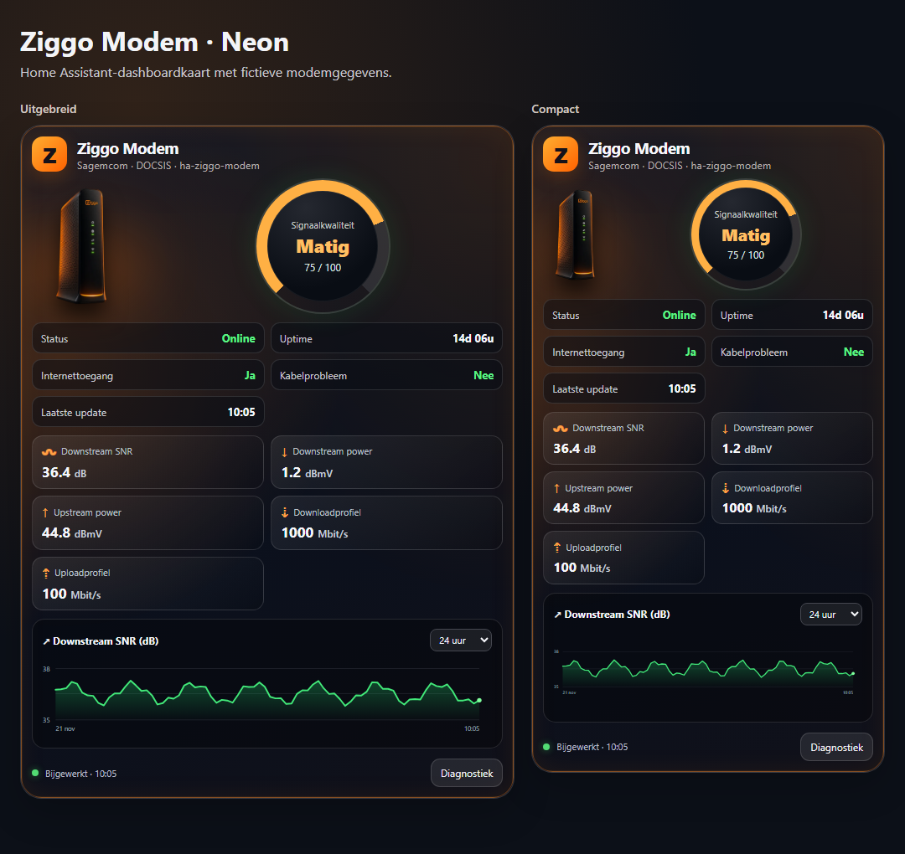

# Ziggo Modem · Neon

[Nederlandse handleiding](../README.md)

A Home Assistant dashboard card for Ziggo modem connectivity, DOCSIS readings, signal quality and downstream SNR history.



## Requirements

Install and configure the Ziggo Modem integration first. The card reads the entities and signal score supplied by that integration. Recorder must track the downstream SNR sensor to show a history chart. [ha-ziggo-modem installation guide](https://github.com/dkwolf1/ha-ziggo-modem#readme)

## Installation

### HACS

Open **HACS → ⋮ → Custom repositories**. Add this repository's GitHub URL as a **Dashboard** repository. Download **Ziggo Modem · Neon**, reload Home Assistant in your browser, then add the card from the dashboard card picker.

### Manual installation

Copy [`ziggo-modem-card.js`](../dist/ziggo-modem-card.js) and [`ziggo-modem-device.webp`](../dist/ziggo-modem-device.webp) into the same Home Assistant folder, for example `/config/www/ziggo-modem-card/`. If you just created the `www` folder, restart Home Assistant once. In **Settings → Dashboards → ⋮ → Resources**, add `/local/ziggo-modem-card/ziggo-modem-card.js?v=1` as a **JavaScript module**. Reload the browser and add the card. [Home Assistant resource guide](https://contributors.home-assistant.io/frontend/custom-ui/resources/)

If you have an earlier test resource registered, remove or replace it so that only one copy of the card loads.

## Configuration

```yaml
type: custom:ziggo-modem-card
```

The visual editor lets you choose the modem, layout, language, chart and tiles. Use **Advanced: map entity IDs** if automatic detection picks the wrong sensor. Diagnostics remain available in the dialog when their tiles are hidden.

The gauge shows the integration's 0–100 signal quality score. **Diagnostics** displays the reason when the sensor supplies it, using the integration's language. **Downstream SNR (dB)** charts 24 hours or seven days of readings from Recorder. Download and upload profiles describe the modem's provisioned bandwidth. A separate speed test is needed to measure throughput.

Run `node --test` from the repository to check the card. See [the Dutch README](../README.md#lokaal-ontwikkelen) for the local demo. [MPL 2.0 license](../LICENSE)
